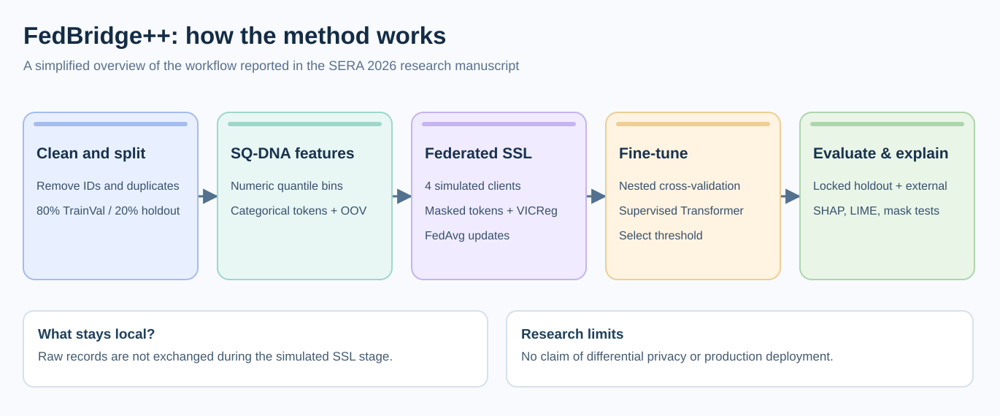
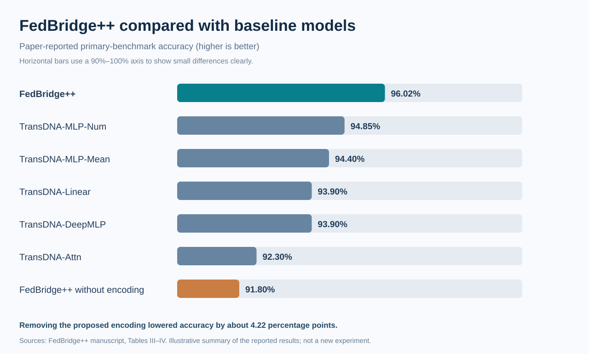

# FedBridge++ — Federated Learning for Explainable Loan Approval

**Research implementation and presentation for the 24th IEEE/ACIS International Conference on Software Engineering Research, Management and Applications (SERA 2026).**

**Paper:** *FedBridge++: Privacy-Preserving Federated Self-Supervision for Tabular Loan Approval with Interpretable Transformers*  
**First author:** **Md. Zubayer Ahmad Shibly** · Southeast University, Bangladesh  
**Conference:** SERA 2026 · Towson University, Maryland, USA · 27–29 May 2026

## About this research

Loan approval is an important financial decision. A machine learning system should not only predict whether a loan will be approved; it should also use reliable data, avoid unfair shortcuts, and make its predictions easier to explain.

**FedBridge++** is a research framework for predicting loan approval from applicant and financial information. It brings together:

- **Careful data preparation** so information from the final test set does not influence model training.
- **SQ-DNA tokenization** to turn numerical and categorical fields into tokens a Transformer can process.
- **Federated self-supervised learning** so simulated clients can learn useful patterns without sending their raw records to a central server during that stage.
- **Explainable AI** to examine why the model makes particular predictions.

The goal is a more transparent and dependable *research workflow*, rather than simply maximizing one accuracy score.

## Results at a glance

These values are **reported in the research manuscript for the primary loan-approval benchmark**, not independently reproduced in this README.

| Measure | FedBridge++ reported result |
| --- | ---: |
| Accuracy | **96.02%** |
| ROC-AUC | **99.50%** |
| PR-AUC | **99.71%** |
| F1-score | **96.8%** |
| Log-loss | **0.103** |

The paper reports a **1.17-percentage-point accuracy improvement** over its strongest accuracy baseline. In an additional component test, removing the proposed encoding reduced accuracy from about **96.02% to 91.80%** (a drop of **4.22 percentage points**).

The comparison is based on Tables III and IV of the manuscript. Results are specific to the reported experimental setup and should not be treated as guarantees for real lending systems.

## How FedBridge++ works

**1. Clean and split the data.** ID-like fields and duplicate records are removed. The dataset is split into 80% TrainVal and a separate 20% holdout *before* fitting data transformations.

**2. Create SQ-DNA tokens.** Numerical values are grouped using supervised-quantile boundaries. Categorical values receive stable per-column token IDs, with a dedicated option for unseen values. A numerical side channel preserves information that simple grouping could lose.

**3. Learn useful representations.** A Transformer encoder, called **DNABridge++**, learns from feature tokens. Self-supervised learning combines **masked-token reconstruction** (predicting hidden tokens) with **VICReg** (encouraging consistent representations of two altered views).

**4. Train across simulated clients.** Four clients perform local self-supervised updates. Their model parameters are combined using **Federated Averaging (FedAvg)**. The study also tests client-specific learning settings.

**5. Select and test the classifier.** Nested cross-validation (five outer folds and three inner folds) helps select supervised fine-tuning settings. The chosen model is evaluated on the separate holdout set.

**6. Check reliability and explanations.** The research examines token stability, responses to small feature changes, **SHAP**, **LIME**, and feature-masking effects. It also includes an external evaluation.

### Research contributions

The paper brings these methods together in one end-to-end pipeline:

- **SQ-DNA:** consistent feature tokenization with supervised numeric bins, categorical vocabularies, and unseen-value handling.
- **DNABridge++:** a tabular Transformer that combines token embeddings with numerical information.
- **Federated SSL:** local masked-token learning plus VICReg, with model aggregation through FedAvg.
- **Careful evaluation:** split-first preprocessing, nested cross-validation, encoding robustness checks, a locked holdout, and external validation.
- **Explainability:** global and individual prediction explanations using more than one method.

## Data and evaluation

The **primary dataset** is the publicly described [Loan Approval Prediction Dataset on Kaggle](https://www.kaggle.com/datasets/architsharma01/loan-approval-prediction-dataset), credited to its original dataset creator. The paper describes the commonly used dataset as having **4,269 rows and 13 columns including the target**.

The target variable is `loan_status`, representing **Approved** or **Rejected**. Features include credit/CIBIL score, income, employment, loan amount, loan term, and asset values.

| Item | Reported setup |
| --- | --- |
| Task | Binary loan approval classification |
| Main data split | 80% TrainVal / 20% locked holdout |
| Federated clients | Four simulated clients |
| Model | DNABridge++ tabular Transformer |
| Self-supervised training | Masked reconstruction + VICReg |
| Federated aggregation | FedAvg |
| Model selection | Nested CV: 5 outer folds, 3 inner folds |
| Explanations | SHAP, LIME, feature masking |
| Additional checks | Encoding stability, ablation, external evaluation |

**Dataset ownership:** The underlying datasets belong to their original publishers. This repository presents research code and materials, not an original dataset collection.

### What the explanations showed

The paper's SHAP and LIME analysis identifies **CIBIL/credit score** as an important driver of model predictions, alongside financial indicators such as income, asset values, and loan terms. These are model explanations, **not a finding that the system is fair, unbiased, or suitable for automated lending decisions**.

## Repository files

| File | Purpose |
| --- | --- |
| [`loanmain.ipynb`](loanmain.ipynb) | Main experimental research notebook |
| [`external-loan.ipynb`](external-loan.ipynb) | Separate external-loan evaluation notebook |
| [`FedBridge SERA 2026 presentation`](FedBridge_SERA_2026_Corrected_22slides_FINAL%20%5BRepaired%5D.pptx) | Conference presentation slides |
| [`assets/fedbridge-workflow.svg`](assets/fedbridge-workflow.svg) | Simplified diagram of the proposed workflow |
| [`assets/model-accuracy.svg`](assets/model-accuracy.svg) | Visual comparison using manuscript results |

The two SVG figures were created as README illustrations from the reported method and results. They are **not exported notebook outputs**.

## Exploring the code

1. Download or clone this repository.
2. Open the relevant `.ipynb` file using Jupyter Notebook, JupyterLab, or a compatible notebook environment.
3. Review the notebook imports, dataset path configuration, and preprocessing steps.
4. Obtain the relevant datasets from their authorized sources. Do not assume the data files are included in this repository.
5. Run the notebook cells in order, using an environment with the required Python packages and sufficient computing resources.

The external evaluation notebook uses **Python, NumPy, pandas, scikit-learn, and PyTorch**. It looks for an appropriate loan CSV (including the `LOAN_CSV` environment variable). A pinned requirements file is not provided, so install package versions compatible with the notebook.

**Reproducibility note:** The two notebooks and paper describe separate evaluations. The external notebook's saved output reports a dataset configuration that differs from the 20,000-record external study described in the manuscript. The paper's external-validation table and paragraph also differ on ROC-AUC. For that reason, no single external-validation score is promoted here as a verified headline.

## Conference and publication context

The accompanying slides identify this work with the **24th IEEE/ACIS International Conference on Software Engineering Research, Management and Applications (SERA 2026)**, hosted at **Towson University, Towson, Maryland, USA, 27–29 May 2026**.

No DOI or publisher indexing link is claimed in this README without a verified record. If you cite the research, please use the full author list and title, and consult the official proceedings for final bibliographic information.

## Research team

Authors as listed on the manuscript:

1. **Md. Zubayer Ahmad Shibly** — Southeast University, Bangladesh (**first author**)
2. Sheikh Arman Karim Aditto — Southeast University, Bangladesh
3. Md. Jahidul Islam — Southeast University, Bangladesh
4. Al-Amain — Southeast University, Bangladesh
5. Maybin K. Muyeba — University of Salford, United Kingdom
6. Mo Saraee — University of Salford, United Kingdom

## About the first author

**Md. Zubayer Ahmad Shibly** is a computer science graduate from **Southeast University, Bangladesh**, with research interests in machine learning, federated learning, explainable AI, and practical decision-support systems.

As first author of this collaborative study, he shares these research notebooks and presentation materials to make the proposed approach easier to understand and explore.

**GitHub:** [@iamshibly](https://github.com/iamshibly)  
**Email:** [zubayer0ahmad@gmail.com](mailto:zubayer0ahmad@gmail.com)

## Important limitations

FedBridge++ is a **research project**, not a deployed banking application. Federated training is simulated using four clients; it does not demonstrate a production network of cooperating financial institutions. Raw data stays local during the simulated federated self-supervised stage, but **differential privacy and end-to-end security guarantees are not claimed**. Fairness analysis and real-world lending validation remain important future work.

The paper's results should be read as experimental evidence for the specified datasets and methods, rather than approval recommendations for real applicants.

## Acknowledgments

This is a collaborative research project. Credit belongs to the **full author team** and their associated institutions, **Southeast University** and **the University of Salford**. The creators of the loan datasets are acknowledged for making the data available for research.

If you build on this work, please acknowledge the authors and the original dataset creators.
